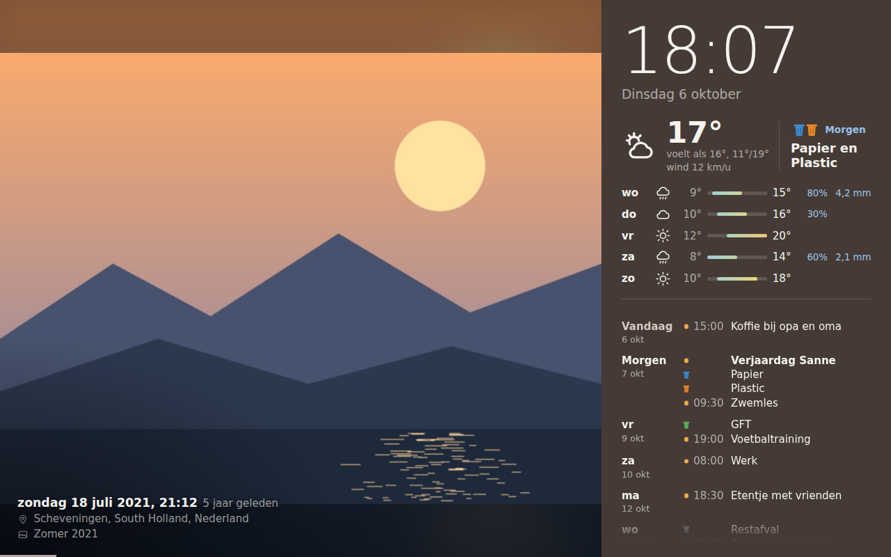
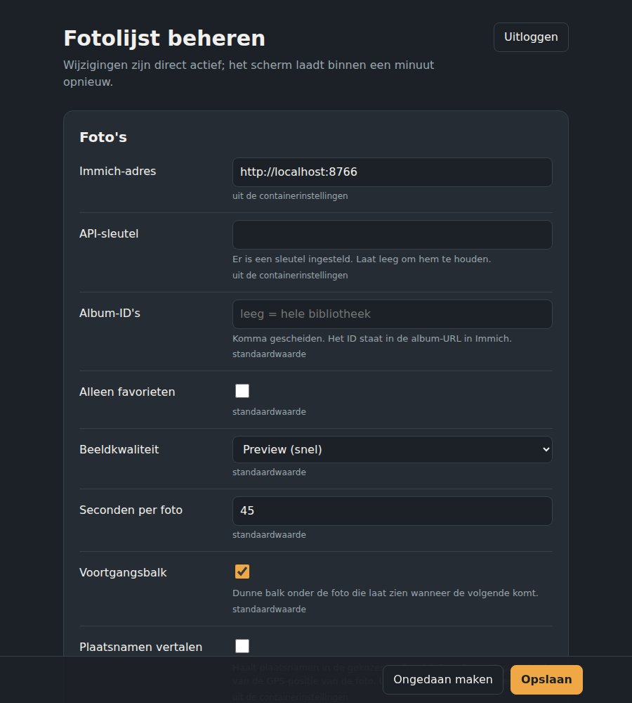

# Immich Wallframe

A wall-mounted photo frame for [Immich](https://immich.app), with a side panel for the things a family checks every day: the time, a 5-day forecast, a compact multi-day agenda and the next waste pickup.



*Interface in Dutch by default; English is built in too (`LOCALE=en-GB`).*

## Features

**Photos**
- Random photos from your whole library, selected albums or favourites, with a smooth crossfade
- Portrait photos get a blurred fill instead of black bars
- Caption with date, time, "x years ago", place, album, people and camera (pick which)
- Place names in your own language via OpenStreetMap (optional)
- Previous / next buttons, swipe and arrow keys; the last 50 photos are remembered
- Progress bar showing when the next photo comes
- The side panel takes on the colour of the current photo

**Panel**
- Large clock and date
- Current weather plus a 5-day forecast with temperature range bars, chance of rain and expected mm ([Open-Meteo](https://open-meteo.com), no API key)
- Compact agenda from any number of iCal feeds (Google, FamilyWall, Outlook, …): one line per event, empty days skipped, scrollable, glides back to today after a minute
- Waste pickups for **Twente Milieu** (Netherlands): the next pickup next to the weather, highlighted the evening before, and optionally in the agenda

**Living with it**
- Night mode on a schedule: black screen or a dimmed, slowly drifting clock; tap to wake
- Admin page to change every setting in the browser, with a connection test
- Choose a font and text size per block (clock, date, weather, forecast, agenda, caption)
- Hidden, password-protected button on the frame that opens the admin page
- Landscape and portrait screens
- Optional Android app for tablets (fullscreen, starts at boot, dims the backlight at night)



## Quick start (Docker Compose)

```yaml
services:
  wallframe:
    image: ghcr.io/planernl/immich-wallframe:latest
    container_name: immich-wallframe
    restart: unless-stopped
    ports:
      - "3050:3000"
    volumes:
      - ./data:/app/data
    environment:
      TZ: Europe/Amsterdam
      ADMIN_PASSWORD: change-me
      IMMICH_URL: http://192.168.1.10:2283
      IMMICH_API_KEY: change-me
```

```bash
docker compose up -d
```

Open `http://<host>:3050` on the screen and `http://<host>:3050/admin` to configure the rest.

### Unraid

Docker tab → **Add Container**:

| Field | Value |
|---|---|
| Repository | `ghcr.io/planernl/immich-wallframe:latest` |
| Port | container `3000` → host `3050` |
| Path | container `/app/data` → `/mnt/user/appdata/immich-wallframe` |
| Variables | `TZ`, `ADMIN_PASSWORD`, `IMMICH_URL`, `IMMICH_API_KEY` |
| Icon URL | `http://<unraid-ip>:3050/icon.png` |

### Build it yourself

```bash
git clone https://github.com/PlanerNL/immich-wallframe.git
cd immich-wallframe
docker build -t immich-wallframe .
```

Or without Docker: `npm ci && node server.js` (Node 20+).

## Immich API key

In Immich: **Account Settings → API Keys → New API Key**. Required permissions:

| Permission | Needed for |
|---|---|
| `asset.read` | picking photos, date and place |
| `asset.view` | showing the image |
| `album.read` | *optional*: album picker on the admin page and album name in the caption |
| `person.read` | *optional*: people in the caption |

## Configuration

Everything can be set on the admin page; settings saved there are stored in `data/settings.json` and take priority over environment variables. Next to each field the admin page shows where its current value comes from, and "reset" returns it to the environment value.

| Variable | Default | Description |
|---|---|---|
| `ADMIN_PASSWORD` | – | Password for `/admin`. Without it the admin page is disabled |
| `IMMICH_URL` | – | Address of your Immich server |
| `IMMICH_API_KEY` | – | API key (see above) |
| `IMMICH_ALBUM_IDS` | all | Comma-separated album IDs. Easier: tick the albums on the admin page |
| `IMMICH_FAVORITES_ONLY` | `false` | Only favourites |
| `IMMICH_IMAGE_SIZE` | `preview` | `preview` (fast) or `fullsize` (sharper on 4K) |
| `PHOTO_INTERVAL` | `45` | Seconds per photo |
| `PROGRESS_BAR` | `true` | Progress bar under the photo |
| `CAPTION` | `date,time,ago,place,album` | Any of `date,time,ago,place,album,people,camera` |
| `PLACE_NAMES_OSM` | `true` | Translate place names via OpenStreetMap (sends the photo's GPS position) |
| `CALENDARS` | – | `Name\|#colour\|url`, separated by `;`. `webcal://` is accepted |
| `CALENDAR_DAYS` | `10` | Days ahead in the agenda |
| `SHOW_EMPTY_DAYS` | `false` | Also show days without appointments ("Niets gepland") |
| `CALENDAR_REFRESH` | `5` | Minutes between calendar refreshes |
| `LATITUDE` / `LONGITUDE` | Amsterdam | Location for the weather |
| `FORECAST_DAYS` | `5` | Number of forecast days (1–14) |
| `LOCALE` | `nl-NL` | Language and date format (`nl-NL`, `nl-BE`, `en-GB`, `en-US`, `de-DE`) |
| `WASTE_POSTCODE` / `WASTE_HOUSE_NUMBER` / `WASTE_HOUSE_LETTER` | – | Address for Twente Milieu pickups. Empty = off |
| `WASTE_SHOW_NEXT` | `true` | Next pickup next to the current weather |
| `WASTE_BANNER_FROM` | `17:00` | From when the evening before the pickup is highlighted |
| `WASTE_IN_AGENDA` | `true` | Pickups in the agenda |
| `ADMIN_BUTTON` | `true` | Invisible button: hold the top-right corner of the frame for 2 s to open the admin page (needs `ADMIN_PASSWORD`). Opened this way, it logs out after 5 minutes of inactivity |
| `FONT_CLOCK`, `FONT_DATE`, `FONT_WEATHER`, `FONT_FORECAST`, `FONT_AGENDA_DAYS`, `FONT_AGENDA`, `FONT_CAPTION` | default | Font per block, e.g. `Oswald`. Choose from the list on the admin page |
| `SIZE_CLOCK`, `SIZE_DATE`, `SIZE_WEATHER`, `SIZE_FORECAST`, `SIZE_AGENDA_DAYS`, `SIZE_AGENDA`, `SIZE_CAPTION` | `100` | Text size per block in percent (50–250) |
| `NIGHT_START` / `NIGHT_END` | – | Night mode, e.g. `23:00` and `07:00`. Empty = off |
| `NIGHT_MODE` | `black` | `black` or `clock` |
| `NIGHT_WAKE_MINUTES` | `2` | How long a tap wakes the frame at night |

## Android app

The `android/` folder contains a small kiosk app that shows the frame fullscreen on a tablet.

- Asks for the frame's address on first start; hold the **top-left corner for 2 seconds** to reopen the settings
- Can act as the home screen, so it starts automatically after a reboot
- Turns the backlight down during night mode
- The back button is disabled so the frame can't be closed by accident

Download the APK from the [Releases](../../releases) page, or from the latest **Android app** run under Actions. To build it yourself: open `android/` in Android Studio, or run `./gradlew assembleDebug` in that folder.

## Troubleshooting

- `docker logs immich-wallframe` shows errors from Immich, calendars and weather
- The admin page has a **Test** button that checks Immich, the weather, each calendar and Twente Milieu
- These endpoints return raw data: `/api/photo/next`, `/api/weather`, `/api/calendar`, `/api/waste`

## Privacy and external services

| Service | What is sent | When |
|---|---|---|
| Your Immich server | API requests | always |
| Open-Meteo | the configured coordinates | every 30 minutes |
| OpenStreetMap Nominatim | rounded GPS position of a photo | once per place, only with `PLACE_NAMES_OSM=true` |
| Twente Milieu | postcode and house number | every 6 hours, only when configured |
| Your iCal providers | a request for the feed | every few minutes |

The Twente Milieu service isn't an official public API; it's the same one their app and the Home Assistant integration use, so it may change without notice. The frame keeps working without it.

The admin page uses plain HTTP and a password. Keep it on your home network or put it behind a reverse proxy with HTTPS.

## License

[MIT](LICENSE) © PlanerNL
